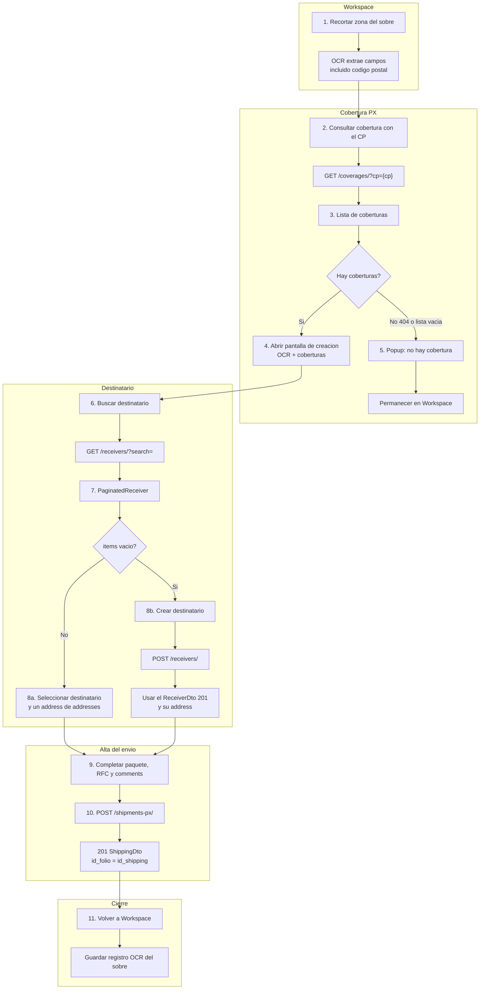
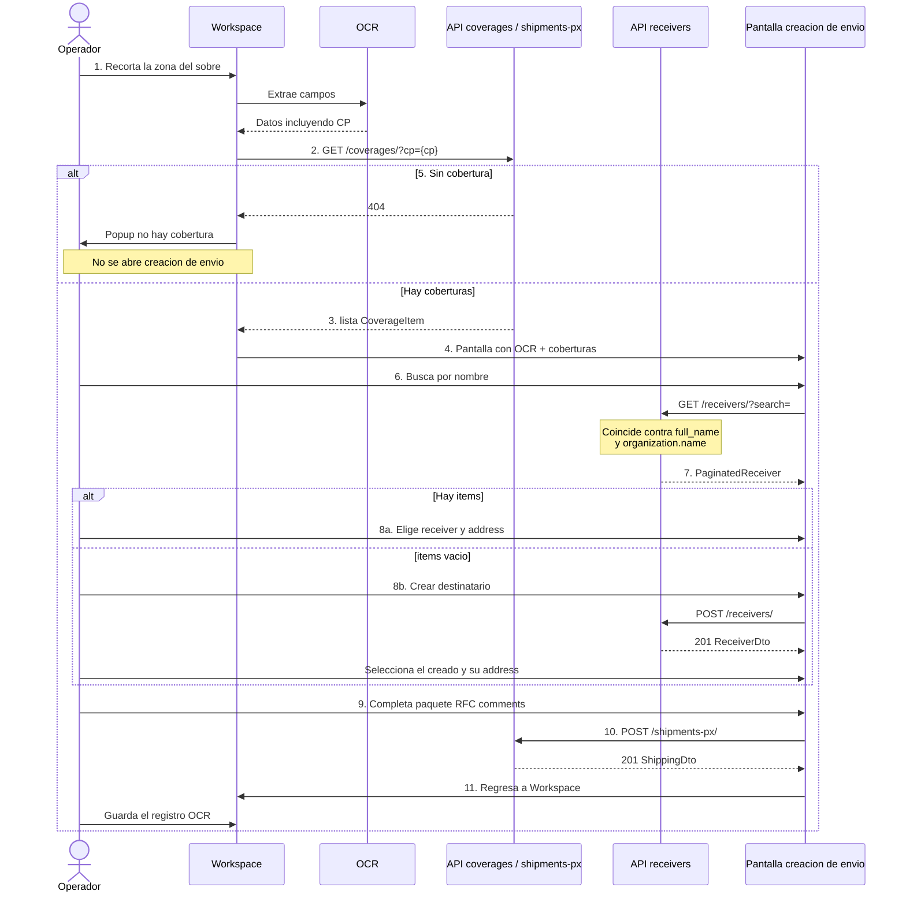

# Flujo: crear envío Paquetexpress

Flujo de escritorio para generar un envío PX a partir del recorte OCR de un sobre. Por ahora Paquetexpress es el único carrier.

Contratos de referencia:

- Destinatarios: [`docs/contratos_endpoints/contrato_receiver.md`](../contratos_endpoints/contrato_receiver.md)
- Envíos PX: [`docs/contratos_endpoints/contrato_shipment_px.md`](../contratos_endpoints/contrato_shipment_px.md)
- Coberturas: `GET /coverages/?cp={cp}` (no hay contrato en `docs/contratos_endpoints/`; el cliente tipa `CoverageItem`)

Auth en todas las llamadas REST: `Authorization: Bearer <access_token>`.

Este flujo **no** usa `PATCH /receivers/{id}`, `GET /shipments-px/`, `GET /shipments-px/{folio}` ni `PUT /shipments-px/{id_shipping}`.

---

## Pasos

1. El usuario recorta la zona a extraer en la imagen del sobre (Workspace).
2. Con el código postal extraído se consulta cobertura Paquetexpress.
3. El backend responde la lista de coberturas.
4. El usuario ve la pantalla de creación de envío con los datos OCR.
5. Si no hay coberturas, sale un popup y el flujo PX se corta; se permanece en Workspace.
6. El usuario busca destinatario. La API busca por `full_name` (PERSONA) o por `position.organization.name` (GOBIERNO / PRIVADA).
7. El backend responde destinatarios paginados (`ReceiverDto` con `addresses` y `contacts`).
8. El usuario selecciona destinatario y domicilio. Si no hay coincidencias, crea el destinatario (`POST /receivers/`) y lo selecciona.
9. Se llenan los datos pendientes del envío (paquete, RFC y comentarios).
10. Se crea el envío (`POST /shipments-px/`) mezclando cobertura + destinatario + paquete.
11. Se regresa a Workspace, donde se puede guardar el registro extraído de la foto.

---

## Diagrama general

## Secuencia

---

## APIs del flujo

| Paso | Método | Ruta | Contrato |
|------|--------|------|----------|
| 2–3, 5 | `GET` | `/coverages/?cp={cp}` | Cliente: lista de `CoverageItem`. 404 = sin cobertura. |
| 6–7 | `GET` | `/receivers/` | `contrato_receiver.md`. Query `search` (mín. 3, máx. 40). |
| 8b | `POST` | `/receivers/` | `contrato_receiver.md`. Crea destinatario + dirección en la misma petición. |
| 10 | `POST` | `/shipments-px/` | `contrato_shipment_px.md`. 201; `id_folio` = `id_shipping`. |

No hay `GET /receivers/{id}`. Tras el alta se usa el `ReceiverDto` del 201.

---

## Búsqueda de destinatario

`GET /receivers/?search={texto}`

- El texto recortado debe quedar en al menos 3 caracteres; si no, 422 `Search debe tener al menos 3 caracteres`.
- Máximo 40. Letras (con acentos y Ñ), dígitos, espacio, punto y guion.
- El servidor busca en mayúsculas, coincidencia parcial, contra:
  - `full_name` (PERSONA)
  - `position.organization.name` (GOBIERNO o PRIVADA)
- Respuesta `200 PaginatedReceiver`: `items[]` son `ReceiverDto`.
- Cero resultados: `total` 0, `items` `[]`, `total_pages` 0. Eso dispara el alta (paso 8b), no un error.
- Filtros opcionales que el escritorio puede usar: `type_entity`, `state`, `page`, `page_size` (5–100), `order_by`, `direction`.

---

## Alta de destinatario si no existe

`POST /receivers/` crea el destinatario y, en la misma petición, su `address` (obligatoria). `contact` y `volante` son opcionales.

| `type_entity` | Obligatorio | Prohibido |
|---------------|-------------|-----------|
| `PERSONA` | `title`, `full_name`, `address` | — |
| `GOBIERNO` | `position` (con `organization`), `address` | `full_name`, `title` |
| `PRIVADA` | `position` (con `organization`), `address` | `full_name`, `title` |

`job_role` dentro de `position` puede omitirse: el servidor asigna cargo fijo (`SIN CARGO`, `INSTITUCIONAL GOBIERNO` o `INSTITUCIONAL PRIVADO`).

Errores que el flujo debe mostrar:

| Status | Caso |
|--------|------|
| 409 | Destinatario duplicado. El body trae `receiver_id`; se puede seleccionar ese id en lugar de reintentar el alta. |
| 422 | Reglas de tipo o formato. |
| 401 | Sesión inválida: volver a login. |

El PATCH de destinatario **no** entra aquí: no actualiza `addresses` ni `contacts`. Si hay que corregir domicilio, se crea otro destinatario o se elige otro `address` ya existente en el DTO.

---

## Mapeo al `POST /shipments-px/`

El alta de envío **no** recibe un `receiver_id`. Copia valores al body plano de `ShippingRequest`.

### De la cobertura seleccionada

Estos campos **no** se toman del domicilio del destinatario ni del OCR.

| Campo envío | Origen cobertura | Notas del contrato PX |
|-------------|------------------|------------------------|
| `colony` | `colony` | 3–60. Mayúsculas en el alta. |
| `postal_code` | `postal_code` | 4–5, solo dígitos. |
| `city` | `city` | 3–60. Mayúsculas. |
| `state` | `state` | 5–50. Texto libre; no usa el catálogo de 32 estados del destinatario. |
| `coverage_type` | `coverage_type` | 4–60. No se pasa a mayúsculas. Ejemplo `PAQUETEXPRESS`. El PUT posterior no puede cambiarlo. |

`municipality` existe en cobertura y en `address` del destinatario; **no** viaja en el envío.

### Del destinatario seleccionado

| Campo envío | Origen `ReceiverDto` | Notas |
|-------------|----------------------|-------|
| `name_receiver` | PERSONA: `full_name`. Opcional prefijo `title.abbreviation`. GOBIERNO/PRIVADA: `position.organization.name` (`full_name` llega `null`) | PX: 4–80, obligatorio. Org puede tener hasta 180: hay que caber en 80. El ejemplo del contrato es `DR. PEPE PINEDO PINEDO`. |
| `country` | `addresses[i].country` | 3–50. |
| `street` | `addresses[i].street` | 3–80. El receiver ya abrevia (`AVENIDA` → `AV.`). El alta PX no vuelve a abreviar. |
| `num_street` | `addresses[i].num_street` | 1–15. |
| `address_reference` | `addresses[i].address_reference` | Opcional, máx. 50. `null` u omitir lo deja vacío. |
| `phone` | `contacts[0].phone` | Receiver: 8–10 dígitos. PX: si se envía, 10–20. Un teléfono de 8–9 dígitos del destinatario no pasa el alta PX. Sin contactos: omitir o `null`. |
| `email` | `email` del destinatario | Opcional, máx. 80. Se guarda tal cual (sin mayúsculas). |

El usuario elige **un** elemento de `addresses`. Si hay varios, no se concatenan.

### No vienen del destinatario

| Campo envío | Quién lo llena | Contrato PX |
|-------------|----------------|-------------|
| `rfc` | Formulario de envío. `ReceiverDto` **no** tiene RFC. | Obligatorio, 12–15. Ejemplo `XAXX-010101-000`. |
| `quantity` | Formulario paquete | Entero ≥ 1 |
| `package_code` | Formulario paquete | 1–63 |
| `content` | Formulario paquete | 10–100, mayúsculas |
| `comments` | Formulario paquete | Enviarlo siempre, 5–80. El schema permite omitirlo, pero el servicio llama `.upper()`. |
| `weight`, `length`, `width`, `height` | Formulario paquete | > 0, máx. 8 dígitos y 2 decimales |

El OCR del sobre es referencia visual. No se manda al alta PX salvo que el usuario lo copie al crear el destinatario o al completar el paquete.

---

## Qué no entra en este flujo

- Guardar el registro OCR es el paso 11, en Workspace, **después** del 201 de envío. Fallar el guardado no deshace el envío ya creado.
- Listar o editar envíos (`GET` / `PUT` de `shipments-px`) es otro flujo.
- Actualizar destinatario (`PATCH`) no corrige domicilio ni teléfono; no sustituye el alta del paso 8b.

---

## Errores a mostrar

| Origen | Status | Comportamiento |
|--------|--------|----------------|
| Cobertura | 404 | Popup: no hay cobertura para ese CP. No abrir creación de envío. |
| Receivers búsqueda | 422 | `search` corto o con caracteres no permitidos. |
| Receivers alta | 409 | Destinatario duplicado; usar el `receiver_id` devuelto. |
| Receivers alta | 422 | Reglas PERSONA / GOBIERNO / PRIVADA o formato. |
| Envío alta | 422 | Validación acumulativa de `ShippingRequest` (longitud, CP, decimales, `comments`, etc.). |
| Cualquiera | 401 | Sesión caducada; relogin. |

El alta PX no pagina y no borra. El folio de respuesta es el mismo número que `id_shipping`.
