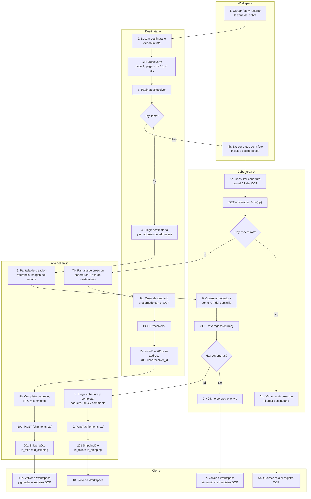
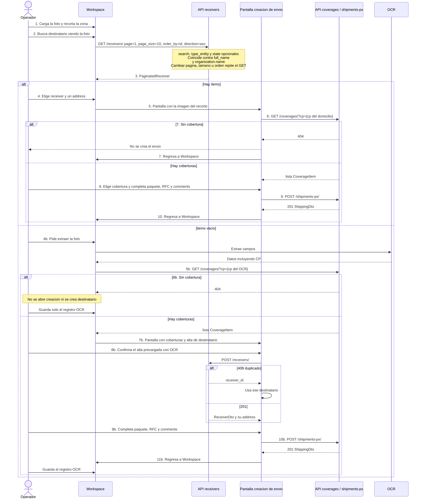

# Flujo: crear envío Paquetexpress

Flujo de escritorio para generar un envío PX a partir de la foto de un sobre. Por ahora Paquetexpress es el único carrier.

El operador ve al destinatario en la foto y lo busca antes de extraer. Si ya existe, se usa un domicilio guardado y se consulta cobertura con ese código postal. Si no existe, se extrae la foto, se consulta cobertura con el código postal del OCR y, solo si hay cobertura, se crea el destinatario y el envío.

Contratos de referencia:

- Destinatarios: [`docs/contratos_endpoints/contrato_receiver.md`](../contratos_endpoints/contrato_receiver.md)
- Domicilios: [`docs/contratos_endpoints/contrato_address.md`](../contratos_endpoints/contrato_address.md)
- Coberturas: [`docs/contratos_endpoints/contrato_coverage_px.md`](../contratos_endpoints/contrato_coverage_px.md)
- Envíos PX: [`docs/contratos_endpoints/contrato_shipment_px.md`](../contratos_endpoints/contrato_shipment_px.md)

Auth en todas las llamadas REST: `Authorization: Bearer <access_token>`.

Este flujo **no** usa `PATCH /receivers/{id}`, `GET /receivers/{id}`, `POST /addresses/{receiver_id}`, `GET /shipments-px/`, `GET /shipments-px/{folio}` ni `PUT /shipments-px/{id_shipping}`.

Que el destinatario exista no implica un envío PX anterior. Destinatario y envío son altas distintas.

---

## Pasos

1. El usuario carga la foto y recorta la zona del sobre (Workspace). El destinatario se ve en la foto. Todavía no hay OCR.
2. Busca destinatario con lo que lee en la foto. `GET /receivers/` arranca en página 1, 10 por página, `order_by=id`, `direction=asc`. Página, tamaño, orden y dirección se pueden cambiar. `search`, `type_entity` y `state` son opcionales.
3. El backend responde destinatarios paginados (`ReceiverDto` con `addresses` y `contacts`).
4. Si hay resultados, elige destinatario y un domicilio de `addresses`. Si solo hay uno, se usa ese.
5. Se abre la pantalla de creación. La referencia es la imagen del recorte.
6. Se consulta cobertura con el código postal de ese domicilio (`GET /coverages/?cp={cp}`).
7. Si responde 404, no se crea el envío y se vuelve a Workspace. En esta rama no hay registro OCR que guardar.
8. Si hay coberturas, elige una y completa paquete, RFC y comentarios.
9. Se crea el envío (`POST /shipments-px/`) mezclando cobertura + destinatario + paquete. El 201 trae `ShippingDto`; `id_folio` = `id_shipping`.
10. Se regresa a Workspace.

Si el paso 3 no trae coincidencias (`total` 0, `items` `[]`), no es un error. Sigue la otra rama:

4b. Se extraen los datos de la foto, incluido el código postal.
5b. Se consulta cobertura con el código postal del OCR (`GET /coverages/?cp={cp}`).
6b. Si responde 404, no se abre la creación ni se crea destinatario. Solo se guarda el registro OCR.
7b. Si hay coberturas, se abre la pantalla de creación con esa lista y, al lado, el alta del destinatario precargada con el OCR.
8b. Se crea el destinatario (`POST /receivers/`), con su domicilio en la misma petición. El 201 se usa tal cual: calle, número, país, referencia y código postal salen de `addresses` de esa respuesta. Con ese código postal se vuelve a consultar cobertura y se preselecciona la colonia del domicilio creado. Si responde 409, se usa el destinatario encontrado, con el mismo criterio.
9b. Se completan paquete, RFC y comentarios.
10b. Se crea el envío (`POST /shipments-px/`).
11b. Se regresa a Workspace y se guarda el registro OCR. Si el guardado falla, el envío ya creado sigue.

---

## Diagrama general

## Secuencia

---

## APIs del flujo

| Paso | Método | Ruta | Contrato |
|------|--------|------|----------|
| 2–3 | `GET` | `/receivers/` | `contrato_receiver.md`. Arranque: `page=1`, `page_size=10`, `order_by=id`, `direction=asc`. |
| 6 y 5b | `GET` | `/coverages/?cp={cp}` | `contrato_coverage_px.md`. Lista de `CoverageItem`. 404 = sin cobertura. En el 6 el `cp` es el del domicilio; en el 5b, el del OCR. |
| 8b | `POST` | `/receivers/` | `contrato_receiver.md`. Crea destinatario + dirección en la misma petición. |
| 9 y 10b | `POST` | `/shipments-px/` | `contrato_shipment_px.md`. 201; `id_folio` = `id_shipping`. |

No hay `GET /receivers/{id}`. Tras el alta se usa el `ReceiverDto` del 201, o el `receiver_id` del 409.

---

## Búsqueda de destinatario

`GET /receivers/`

Ocurre en el paso 2, con la foto a la vista y sin OCR. El operador escribe lo que lee en el sobre.

La primera consulta del flujo manda:

| Query | Valor de arranque | Se puede cambiar a |
|-------|-------------------|--------------------|
| `page` | `1` | entero ≥ 1 |
| `page_size` | `10` | 5–100 |
| `order_by` | `id` | `id`, `full_name`, `name_org`, `created_at` |
| `direction` | `asc` | `asc`, `desc` |

Si se omite `page_size`, el contrato usa 50. Este flujo lo manda en 10. Cambiar página, tamaño u orden vuelve a llamar `GET /receivers/` con los mismos filtros. Si la página pedida pasa de la última, la respuesta trae la última que existe.

- `search` es opcional. Si viene, el texto recortado debe quedar en al menos 3 caracteres; si no, 422 `Search debe tener al menos 3 caracteres`. Máximo 40. Letras (con acentos y Ñ), dígitos, espacio, punto y guion.
- El servidor busca en mayúsculas, coincidencia parcial, contra:
  - `full_name` (PERSONA)
  - `position.organization.name` (GOBIERNO o PRIVADA)
- `type_entity` (`PERSONA`, `GOBIERNO`, `PRIVADA`) y `state` (estado de alguna dirección) son filtros opcionales.
- Respuesta `200 PaginatedReceiver`: `items[]` son `ReceiverDto`.
- Cero resultados: `total` 0, `items` `[]`, `total_pages` 0. Eso abre la extracción (paso 4b), no el alta y no es un error.

---

## Alta de destinatario si no existe

Solo corre en el paso 8b, después de confirmar cobertura (paso 5b). La pantalla de creación muestra las coberturas y, al lado, el formulario de alta precargado con el OCR. La búsqueda del paso 2 ya dio vacía, así que esta pantalla no vuelve a buscar.

`POST /receivers/` crea el destinatario y, en la misma petición, su `address` (obligatoria). `contact` y `volante` son opcionales.

| `type_entity` | Obligatorio | Prohibido |
|---------------|-------------|-----------|
| `PERSONA` | `title`, `full_name`, `address` | — |
| `GOBIERNO` | `position` (con `organization`), `address` | `full_name`, `title` |
| `PRIVADA` | `position` (con `organization`), `address` | `full_name`, `title` |

`job_role` dentro de `position` puede omitirse: el servidor asigna cargo fijo (`SIN CARGO`, `INSTITUCIONAL GOBIERNO` o `INSTITUCIONAL PRIVADO`).

Errores que el flujo debe mostrar:

| Status | Caso |
|--------|------|
| 409 | Destinatario duplicado. El body trae `receiver_id`; se usa ese id y se sigue al alta del envío. |
| 422 | Reglas de tipo o formato. |
| 401 | Sesión inválida: volver a login. |

El PATCH de destinatario **no** entra aquí: no actualiza `addresses` ni `contacts`. Si hay que corregir domicilio, se crea otro destinatario o se elige otro `address` ya existente en el DTO. El contrato de domicilio no tiene campo de domicilio principal.

---

## Mapeo al `POST /shipments-px/`

El alta de envío **no** recibe un `receiver_id`. Copia valores al body plano de `ShippingRequest`.

El código postal con el que se consulta cobertura es el del domicilio elegido (paso 6) o, tras crear al destinatario, el de `addresses` en la respuesta del alta (paso 8b). El paso 5b solo abre la pantalla con el código postal del OCR. Colonia, código postal, ciudad, estado y tipo del envío salen de la cobertura que quede seleccionada; la colonia inicial es la del domicilio devuelto, si está en esa lista.

### De la cobertura seleccionada

Estos campos **no** se toman del domicilio del destinatario ni del OCR.

| Campo envío | Origen cobertura | Notas del contrato PX |
|-------------|------------------|------------------------|
| `colony` | `colony` | 3–60. Mayúsculas en el alta. |
| `postal_code` | `postal_code` | 4–5, solo dígitos. |
| `city` | `city` | 3–60. Mayúsculas. |
| `state` | `state` | 5–50. Texto libre; no usa el catálogo de 32 estados del destinatario. |
| `coverage_type` | `coverage_type` | 4–60. No se pasa a mayúsculas. Ejemplo `PAQUETEXPRESS`. El PUT posterior no puede cambiarlo. |

`municipality` existe en cobertura y en `address` del destinatario; **no** viaja en el envío.

### Del destinatario seleccionado

| Campo envío | Origen `ReceiverDto` | Notas |
|-------------|----------------------|-------|
| `name_receiver` | PERSONA: `title.abbreviation` + `full_name` + ` / ` + `job_role.abbreviation` + ` EN ` + `organization.name`. Cargo y organización son opcionales; `EN` solo va si hay ambos. GOBIERNO/PRIVADA: `position.organization.name` | PX: 4–80, obligatorio. Se recorta a 80. |
| `country` | `addresses[i].country` | 3–50. |
| `street` | `addresses[i].street` | 3–80. El receiver ya abrevia (`AVENIDA` → `AV.`). El alta PX no vuelve a abreviar. |
| `num_street` | `addresses[i].num_street` | 1–15. |
| `address_reference` | `addresses[i].address_reference` | Opcional, máx. 50. `null` u omitir lo deja vacío. |
| `phone` | `contacts[0].phone` | Receiver: 8–10 dígitos. PX: si se envía, 10–20. Un teléfono de 8–9 dígitos del destinatario no pasa el alta PX. Sin contactos: omitir o `null`. |
| `email` | `email` del destinatario | Opcional, máx. 80. Se guarda tal cual (sin mayúsculas). |

El usuario elige **un** elemento de `addresses`. Si hay uno solo, se usa ese. Si hay varios, no se concatenan.

### No vienen del destinatario

| Campo envío | Quién lo llena | Contrato PX |
|-------------|----------------|-------------|
| `rfc` | Formulario de envío. `ReceiverDto` **no** tiene RFC. | Obligatorio, 12–15. Ejemplo `XAXX-010101-000`. |
| `quantity` | Formulario paquete | Entero ≥ 1 |
| `package_code` | Formulario paquete | 1–63 |
| `content` | Formulario paquete | 10–100, mayúsculas |
| `comments` | Formulario paquete | Enviarlo siempre, 5–80. El schema permite omitirlo, pero el servicio llama `.upper()`. |
| `weight`, `length`, `width`, `height` | Formulario paquete | > 0, máx. 8 dígitos y 2 decimales |

En la rama del destinatario existente la referencia de la pantalla es la imagen del recorte: no hay campos OCR. En la rama de alta, los campos OCR se muestran para contrastar y precargan el formulario del destinatario. El OCR no se manda al alta PX salvo que el usuario lo copie al crear el destinatario o al completar el paquete.

---

## Qué no entra en este flujo

- Guardar el registro OCR solo ocurre en la rama sin destinatario: en el paso 6b si no hay cobertura, o en el 11b después del 201. Fallar ese guardado no deshace el envío ya creado. La rama con destinatario existente no extrae, así que no guarda registro OCR.
- Un destinatario encontrado no demuestra que ya se haya creado un envío PX con ese domicilio.
- Marcar un domicilio como principal no entra: `contrato_address.md` no tiene ese campo.
- Listar o editar envíos (`GET` / `PUT` de `shipments-px`) es otro flujo.
- Actualizar destinatario (`PATCH`) no corrige domicilio ni teléfono; no sustituye el alta del paso 8b.
- Agregar otro domicilio a un destinatario ya existente (`POST /addresses/{receiver_id}`) no entra. Se elige uno de `addresses`.

---

## Errores a mostrar

| Origen | Status | Comportamiento |
|--------|--------|----------------|
| Cobertura, destinatario ya elegido (paso 6) | 404 | No se crea el envío. Se vuelve a Workspace. No hay registro OCR. |
| Cobertura, tras el OCR (paso 5b) | 404 | No se abre creación ni se crea destinatario. Se guarda el registro OCR. |
| Cobertura | 422 | `cp` ausente, de menos de 4 o de más de 5 caracteres. |
| Receivers búsqueda | 422 | `search` corto o con caracteres no permitidos. Página, tamaño u orden fuera de los literales del contrato. |
| Receivers alta | 409 | Destinatario duplicado; usar el `receiver_id` devuelto y seguir al envío. |
| Receivers alta | 422 | Reglas PERSONA / GOBIERNO / PRIVADA o formato. |
| Envío alta | 422 | Validación acumulativa de `ShippingRequest` (longitud, CP, decimales, `comments`, etc.). |
| Cualquiera | 401 | Sesión caducada; relogin. |

El alta PX no pagina y no borra. El folio de respuesta es el mismo número que `id_shipping`.
